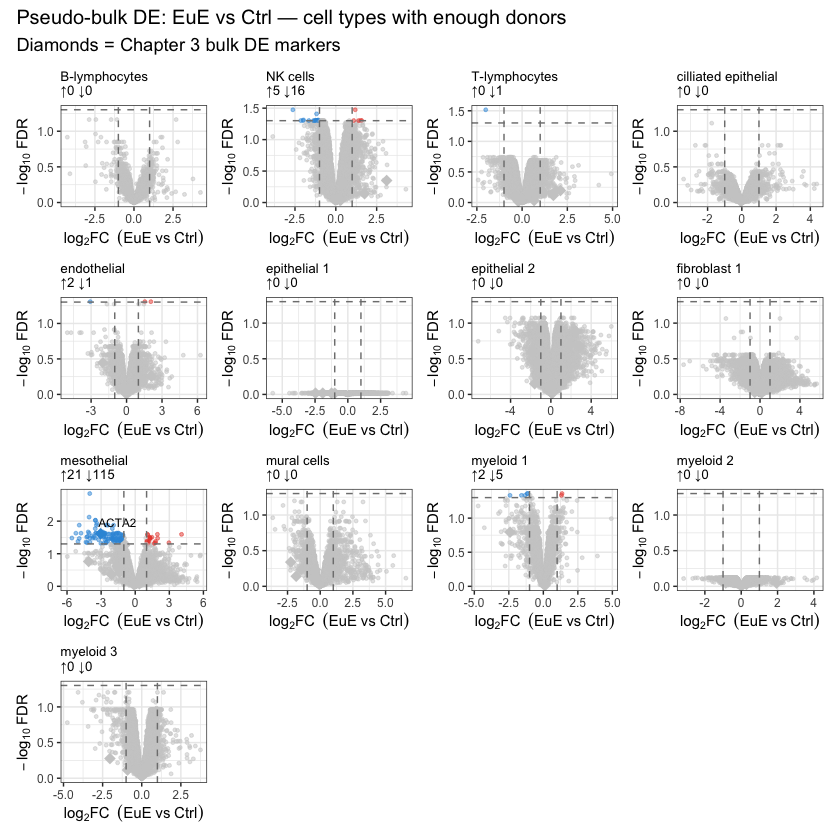

# Differential analysis, single-cell to pseudobulk

> *In the book: Sections 3.10 to 3.12 (the dataset) and Section 9.2.8 (pseudobulk and limma-voom).*

:::{admonition} What you'll learn
:class: tip

- Turn single-cell counts into one pseudobulk sample per cell type, donor and condition.
- Test for differences between endometriosis and control with limma-voom.
- Read a volcano plot, and check the result against genes you already know.
:::

The data are the public endometriosis single-cell atlas from The Jackson
Laboratory (Tan et al., 2022, *Nature Cell Biology*, PMID 35864314). The
notebooks download what they need from the JAX Single Cell Portal, so there
is nothing to copy by hand. The global file is 8.17 GB. The stromal and
lymphocyte subtype files that the first notebook also fetches add about
3.1 GB and 1.1 GB. Allow the disk space and some time. In the data, the
control group is labelled `Ctrl` and the patients' eutopic endometrium
`EuE`; the notebooks and the workflow use the same labels.

## Run them in order

1. [`pseudobulk_limma_voom.ipynb`](https://github.com/Science-and-Technology-Consulting-LLC/elements-of-style-lessons/blob/main/lessons/differential-analysis/pseudobulk_limma_voom.ipynb)
   (Python 3 kernel). Downloads the h5ad, sums raw counts per cell type,
   donor and condition, and writes CSVs to `pseudobulk/`.
2. [`limma_voom_de.ipynb`](https://github.com/Science-and-Technology-Consulting-LLC/elements-of-style-lessons/blob/main/lessons/differential-analysis/limma_voom_de.ipynb)
   (R kernel). Reads those CSVs, runs limma-voom for each cell type, and
   draws the volcano plots.

Run the first before the second. Use "Restart and Run All" in each.

A third notebook stands apart. [`make_test_data.ipynb`](https://github.com/Science-and-Technology-Consulting-LLC/elements-of-style-lessons/blob/main/lessons/differential-analysis/make_test_data.ipynb)
(Python 3 kernel) cuts the large file down to a small h5ad per cell type.
Those small files are the input for the `-profile test` runs of the
workflow below. You choose the cell types in Step 4.

## What the run looks like

On a laptop, with nine eutopic endometriosis donors (EuE) and three
control donors (Ctrl), 13 of the 18 cell types had enough donors in both
groups to test. The figure shows one volcano plot for each of them. Grey
points pass neither threshold. Coloured points have an adjusted p value
below 0.05 and an absolute log2 fold change above 1.

The same analysis for the stromal and lymphocyte subtypes is in
`images/limma_voom_de_02.png` and `images/limma_voom_de_03.png`.

## Why pseudobulk

Cells from one donor are not independent of each other. Testing every cell
as a separate sample overstates the evidence. Summing counts per donor makes
the donor the unit of replication, and a bulk method such as limma-voom
then applies.

## The same steps as a workflow

The five limma-voom modules in [`modules/limma-voom/`](https://github.com/Science-and-Technology-Consulting-LLC/elements-of-style-lessons/tree/main/modules/limma-voom)
and the stitched [`main-bulk-de.nf`](https://github.com/Science-and-Technology-Consulting-LLC/elements-of-style-lessons/blob/main/main-bulk-de.nf) run this analysis
as a Nextflow workflow. See [Nextflow workflows](../nextflow-workflows/index.md).

## Where to go next

The case study that this lesson draws on is in
[`case-studies/endometriosis/`](https://github.com/Science-and-Technology-Consulting-LLC/elements-of-style-lessons/blob/main/case-studies/endometriosis/README.md).
