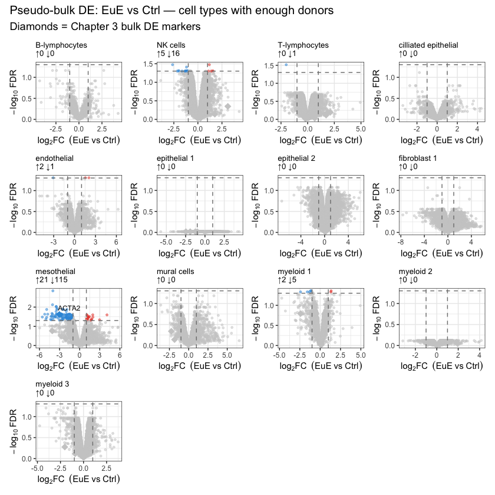

# Differential analysis, single-cell to pseudobulk

> *In the book: Sections 3.10 to 3.12 (the dataset) and Section 9.2.8 (pseudobulk and limma-voom).*

:::{admonition} What you'll learn
:class: tip

- Turn single-cell counts into one pseudobulk sample per cell type, donor and condition.
- Test for differences between endometriosis and control with limma-voom.
- Read a volcano plot, and check the result against genes you already know.
:::

## Start here

### Before you start

The previous lesson is [Nextflow modules and features](../nextflow-modules/README.md). You also need a free [GitHub account](https://github.com/signup) and the setup from [Let's dive in](../introduction/lets-dive-in.md).

### The data

The data are the public endometriosis single-cell atlas from The Jackson
Laboratory (Tan et al., 2022, *Nature Cell Biology*, PMID 35864314). The
notebooks download what they need from the JAX Single Cell Portal, so there
is nothing to copy by hand. The global file is 8.17 GB. The stromal and
lymphocyte subtype files that the first notebook also fetches add about
3.1 GB and 1.1 GB. Allow the disk space and some time. In the data, the
control group is labelled `Ctrl` and the patients' eutopic endometrium
`EuE`; the notebooks and the workflow use the same labels.

## Steps to execute

1. [`pseudobulk_limma_voom.ipynb`](https://github.com/Science-and-Technology-Consulting-LLC/elements-of-style-lessons/blob/main/lessons/differential-analysis/pseudobulk_limma_voom.ipynb)
   (Python 3 kernel). Downloads the h5ad, sums raw counts per cell type,
   donor and condition, and writes CSVs to `pseudobulk/`.
2. [`limma_voom_de.ipynb`](https://github.com/Science-and-Technology-Consulting-LLC/elements-of-style-lessons/blob/main/lessons/differential-analysis/limma_voom_de.ipynb)
   (R kernel). Reads those CSVs, runs limma-voom for each cell type, and
   draws the volcano plots.

Run the first before the second. Use "Restart and Run All" in each.

A third notebook stands apart. [`make_test_data.ipynb`](https://github.com/Science-and-Technology-Consulting-LLC/elements-of-style-lessons/blob/main/lessons/differential-analysis/make_test_data.ipynb)
(Python 3 kernel) cuts the large file down to a small h5ad per cell type.
Those small files are the input for the `-profile test` runs of the
workflow below. You choose the cell types in the notebook itself.

## Ask an AI assistant

*Optional.* Read [Using the AI prompts](../introduction/README.md) first: what to paste, what never to paste, and how to check the answer.

**Ask it to explain.**

```text
Explain why testing every cell as a separate sample overstates the evidence, and what pseudobulk does about it. Use my case: <donors, conditions, cell types>. Cite the methods paper that supports your answer so I can read it.
```

**Ask it to build.**

```text
I have a pseudobulk count table with one column per donor and cell type, and a sample sheet with columns donor, condition and cell_type. Write R code that runs limma-voom for one cell type, with condition as the effect, and writes a table of log fold change, adjusted p value and gene. Say which assumptions it makes and how I can check each.
```

**Ask it to review.**

```text
Review my design: <paste the sample sheet summary and the formula>. Is there confounding (for example, every control from one batch)? Are there enough donors in each group for each cell type? What should I report as a limit of the analysis? Do not invent results.
```


## Further reading

- Law CW, Chen Y, Shi W, Smyth GK. voom: precision weights unlock linear model analysis tools for RNA-seq read counts. *Genome Biology* 2014. doi: [10.1186/gb-2014-15-2-r29](https://doi.org/10.1186/gb-2014-15-2-r29).
- Ritchie ME, Phipson B, Wu D, et al. limma powers differential expression analyses for RNA-sequencing and microarray studies. *Nucleic Acids Research* 2015. doi: [10.1093/nar/gkv007](https://doi.org/10.1093/nar/gkv007).
- Squair JW, Gautier M, Kathe C, et al. Confronting false discoveries in single-cell differential expression. *Nature Communications* 2021. doi: [10.1038/s41467-021-25960-2](https://doi.org/10.1038/s41467-021-25960-2). The case for pseudobulk.
- Tan Y, et al. Single-cell analysis of endometriosis reveals a coordinated transcriptional programme driving immunotolerance and angiogenesis across eutopic and ectopic tissues. *Nature Cell Biology* 2022. [PubMed 35864314](https://pubmed.ncbi.nlm.nih.gov/35864314/).

> **Check:** the author list of the Tan et al. paper is shortened here. Please give the full first author's name as you cite it.

## Supplementary information

### What the run looks like

On a laptop, with nine eutopic endometriosis donors (EuE) and three
control donors (Ctrl), 13 of the 18 cell types had enough donors in both
groups to test. The figure shows one volcano plot for each of them. Grey
points pass neither threshold. Coloured points have an adjusted p value
below 0.05 and an absolute log2 fold change above 1.



The same analysis for the stromal and lymphocyte subtypes is in
`images/limma_voom_de_02.png` and `images/limma_voom_de_03.png`.

### Why pseudobulk

Cells from one donor are not independent of each other. Testing every cell
as a separate sample overstates the evidence. Summing counts per donor makes
the donor the unit of replication, and a bulk method such as limma-voom
then applies.

### The same steps as a workflow

The five limma-voom modules in [`modules/limma-voom/`](https://github.com/Science-and-Technology-Consulting-LLC/elements-of-style-lessons/tree/main/modules/limma-voom)
and the stitched [`main-bulk-de.nf`](https://github.com/Science-and-Technology-Consulting-LLC/elements-of-style-lessons/blob/main/main-bulk-de.nf) run this analysis
as a Nextflow workflow. See [Introduction to Nextflow](../nextflow-workflows/README.md) and [Nextflow modules and features](../nextflow-modules/README.md).

## Next

[Federated computing](../federated-computing/README.md): run the same analysis where the data stay. The case study this lesson draws on is [Endometriosis](../../case-studies/endometriosis/README.md).
