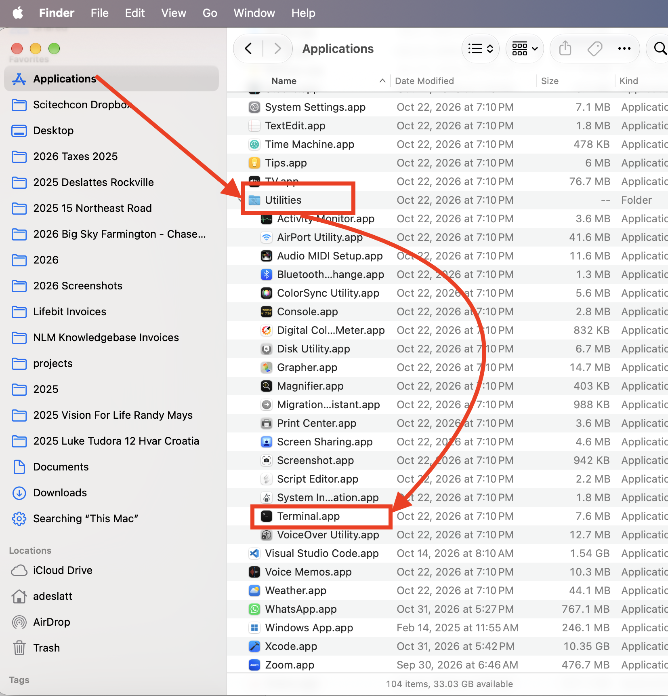
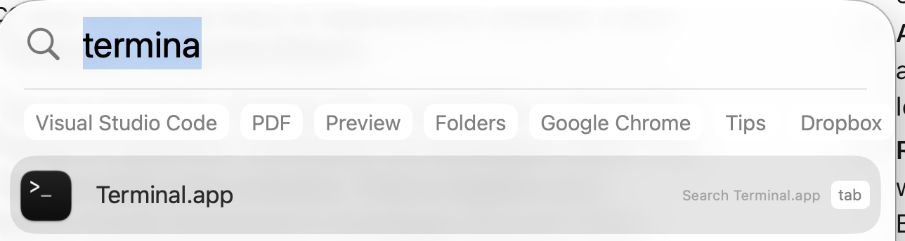
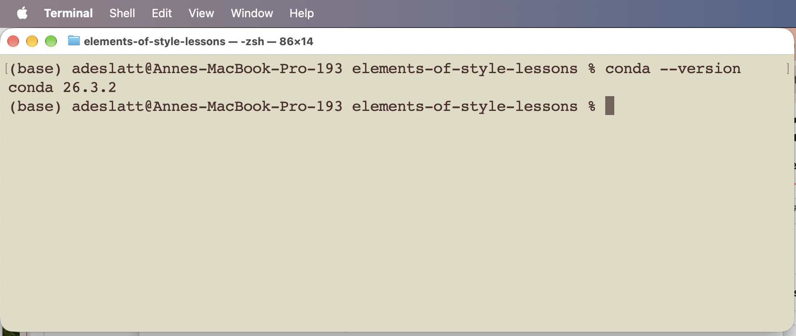
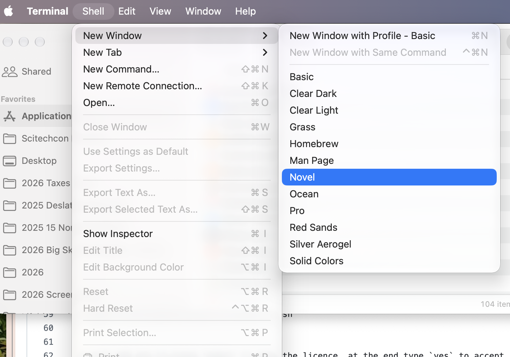

# Introduction

This lesson explains why the course follows *The Elements of Style*, then walks you through setting up your computer and running a first notebook.

> *In the book: the Introduction, and Chapter 3 — Elements of Style.*

## Start here

### Pre-requisites

This is the first lesson, there are no pre-requisites.

1. **Open a terminal.**

On a Mac, open *Terminal*.   

You can find *Terminal* using the *Finder App* in *Applications/Utilities*



A keyboard alternative is to press keys in succession **command** followed by **space bar**.  In the resulting **search** window (**spy glass**), type **Terminal**.



On Windows, open *Git Bash*. On Linux, open your terminal program. No terminal at hand? See [Other places to run these lessons](other-places-to-run.md). If `git` is missing, install it from [git-scm.com](https://git-scm.com/downloads). On Windows that also installs Git Bash.

2. **Get the lessons.**

In the terminal window, copy and paste these two lines, then press Return:

   ```bash
   git clone https://github.com/Science-and-Technology-Consulting-LLC/elements-of-style-lessons.git
   cd elements-of-style-lessons
   ```

3. **Install conda**

In the terminal window, if you see:

![what-you-see-when-you-don't-have-conda[(https://github.com/Science-and-Technology-Consulting-LLC/elements-of-style-lessons/blob/main/lessons/introduction/assets/Terminal-before-miniconda-install.png), you do not have *conda/miniconda* installed.

As a final check, type in the terminal window or simply copy and paste this command: 

```bash
conda --version
```

You do have conda installed if you see:


Seeing a version number, proceed to step 4. 

If you didn't see either the word `(base)` or a version number, you now must install **Miniforge**. 

On a Mac or Linux, copy and paste the following in a terminal window. And then press the `Return` key.

   ```bash
   curl -L -O "https://github.com/conda-forge/miniforge/releases/latest/download/Miniforge3-$(uname)-$(uname -m).sh"
   bash "Miniforge3-$(uname)-$(uname -m).sh"
   ```

It will ask you to press 'space' to read the licence, at the end type `yes` to accept it, also accept the default folder, and answer `yes` when it asks to initialize conda:

   On Windows, download `Miniforge3-Windows-x86_64.exe` from [conda-forge.org/download](https://conda-forge.org/download/) and run it. 
   
   **close the termina**.  Press the **red** dot and close the terminal window.
   
   Now open a new one.  (If you are wondering which one is used in these lessons, I am using Novel Terminal style.  One can open a *Terminal* *New Window* like what you see by selecting *Novel*.
   

   Now, proceed to our lessons directory:
   
   ```bash
   cd elements-of-style-lessons
   ```
   Continue to Step 4.
   
4. **Create the `eos` environment.**

   In later lessons, we will explain why we do this and you will understand that we are creating an environment that will allow us to run each of the lessons.  It is a clean environment, where all our libraries and required tools are installed, so we can proceed error free.  More on this later.

   For now, please copy and paste the following lines in the new terminal window you have opened.
You will now see, since miniconda has been installed, the words **(base)** next to your prompt.  *Prompt* is the name given to the letters and words that preceed where you can type.

   ```bash
   conda env create -f eos.yml
   conda activate eos
   python -m bash_kernel.install
   R -e 'IRkernel::installspec(name="ir", displayname="R")'
   ```
   What we have done is the following:
   * created a new environment called *eos*.
   * activated this environment
   * and installed the bash kernel
   * And installed the R kernel

   A Kernel is required to run what we will use next, Jupyter Lab notebooks.  Jupyter Lab notebooks come with a Python Kernel, but for our lessons we will also use Bash (we are in a shell in our terminal, on a mac this is a Z-shell, in a git bash environment there is a bash shell.  There is more information on shells that you can read about in the further reading session.
   We will also learn about conda environments later.  But for now, we are just getting started.
   
   Your prompt now starts with `(eos)`.

5. **Start JupyterLab.** 

   we have set things up and now we are ready to start our first lesson.  To do this, copy and paste the following command in your terminal window.
   
   ```bash
   jupyter lab
   ```

   A browser tab opens with JupyterLab.  For these lessons, the Chrome browser on the Mac was used.

   If it does not, copy the address that starts with `http://localhost` from the terminal into a new browser tab.

6. **Open the first lesson.**
  
In the file list on the left of JupyterLab, double-click `lessons`, then `introduction`, then `lets-dive-in.ipynb`. If it asks you to select a kernel, choose **Bash**. 

Navigating around the `Jupyter Lab Notebook` you have opened, you see 


> **Check:** the Miniforge lines come from the [Miniforge page](https://github.com/conda-forge/miniforge#install). I have not run these steps in order on a fresh computer. Please try them on one and tell me where you get stuck.

### What you should see

- `git --version` and `conda --version` each print a version number.
- A `(eos)` prefix on your terminal prompt after `conda activate eos`.
- JupyterLab opens in your browser with a **Bash** tile in the Launcher.
- A list of tools, each with a location or the word `MISSING`.

### Where the files are

- `lessons/introduction/README.md` — this page.
- `lessons/introduction/lets-dive-in.ipynb` — the notebook you run.
- `lessons/introduction/lets-dive-in.md` — the same steps as a web page.
- `eos.yml` in the repository root — the recipe for the conda environment.

## Steps to execute

1. [Let's dive in](lets-dive-in.md) — find your way around JupyterLab, run a first cell and check your tools.

## Ask an AI assistant

*Optional.* An AI assistant can explain a step, write a first draft of the code, or review what you wrote. It does not know your computer, and it can be wrong with great confidence. Use it the way you use a colleague who works fast: say exactly what you want, and check the result.

### Using the AI prompts

Every lesson has a box like this one, with prompts for three jobs: *explain*, *build* and *review*. They work in a chat assistant such as [Claude](https://claude.ai/), [ChatGPT](https://chatgpt.com/) or [Gemini](https://gemini.google.com/), and in a coding agent such as [Claude Code](https://www.anthropic.com/claude-code), [OpenAI Codex](https://openai.com/codex/) or the [Gemini CLI](https://github.com/google-gemini/gemini-cli), where the tool is available to you.

1. **Say exactly what you want.** Give the goal, the inputs, the outputs, the limits, and what a good answer looks like. Paste the exact error message, the command you ran, and the file. A prompt without them gets a guess.
2. **Never paste secrets or patient data.** No passwords, tokens, API keys or sample identifiers. Replace them with placeholders such as `<TOKEN>`.
3. **Know what the tool can see.** A chat assistant sees only what you paste. A coding agent works in a folder on your computer and can run commands. Start it in a practice folder such as `~/eos-practice`, not in your real project, and read every command before you approve it.
4. **Check the answer.** Run it on the lesson's small test data. Compare the output with *What you should see* in the lesson. Ask the assistant where each claim comes from, and open the source. For a method in your science, read the paper yourself.
5. **Keep what works.** When a prompt gives you good code, save the prompt next to the code, as you would a method.

> **Check:** the names and features of these tools change often. Please confirm the product names and links before the course starts.

**Ask it to plan.**

```text
I am a biomedical researcher. I can use a spreadsheet and I have never used a terminal.
My goal is to run a bioinformatics analysis that a colleague can repeat. I have a Mac
(or: a Windows computer). Using the lesson list at the top of the Introduction page of the
Elements of Style course, tell me which lessons I should do first, which I can skip, and
why. Ask me up to five questions about my experience before you answer.
```

## Further reading

- Wilson G, Aruliah DA, Brown CT, et al. Best practices for scientific computing. *PLoS Biology* 2014. doi: [10.1371/journal.pbio.1001745](https://doi.org/10.1371/journal.pbio.1001745).
- Sandve GK, Nekrutenko A, Taylor J, Hovig E. Ten simple rules for reproducible computational research. *PLoS Computational Biology* 2013. doi: [10.1371/journal.pcbi.1003285](https://doi.org/10.1371/journal.pcbi.1003285).
- Rule A, Birmingham A, Zuniga C, et al. Ten simple rules for writing and sharing computational analyses in Jupyter Notebooks. *PLoS Computational Biology* 2019. doi: [10.1371/journal.pcbi.1007007](https://doi.org/10.1371/journal.pcbi.1007007).
- Strunk W Jr, White EB. *The Elements of Style*. Allyn and Bacon.
- Kernighan BW, Plauger PJ. *The Elements of Programming Style*. McGraw-Hill.

> **Check:** I could not open a catalogue page for the two books, so the edition and publisher details come from memory. Please give the edition you use.

## Supplementary information

### The spirit

Strunk and White called *The Elements of Style* a summation of the case for cleanliness, accuracy and brevity in the use of English. Kernighan and Ritchie, and Kernighan and Plauger, brought the same spirit to programming. These lessons bring it to biomedical workflows.

Brevity and clarity matter even more when you work with an AI agent. A computer cannot reason or judge. You must say exactly what you want, and be sure of your correctness.

### The dry workbench

Treat your work on the computer like the wet bench. Keep the area clean. Make the experiment repeatable, so anyone gets the same result.

- Be clear with every step.
- Keep your environment clean.
- Do not reinvent the wheel. Find working code that already exists.
- Add a command line interface, so each step is accessible.
- Assemble the steps into a repeatable standard operating procedure.
- Inspect, simplify, and pull apart convoluted steps.
- Test, iterate and refine.
- Automate, reuse and repeat.

### Who it is for

Working scientists at any career stage, from a first terminal session to a Nextflow pipeline. Anyone whose work has to live somewhere other than a laptop.

### What you need

A computer with a terminal, a browser, and a GitHub account. The lessons work on a Mac, on Windows with Git Bash, and on Linux. You do not need administrator rights. No terminal of your own? See [Other places to run these lessons](other-places-to-run.md).

### The order of the lessons

Each lesson builds on the one before it.

1. **Set the stage.** This lesson, then [The Rules](../elements-of-style-rules/README.md).
2. **Foundation.** [Command line, with Git Bash](../command-line-and-git-bash/README.md), [Version control with Git](../version-control/README.md), [Reproducible environments with Conda](../conda-environments/README.md), [Interactive computing with Jupyter](../interactive-computing/README.md).
3. **Build.** [Reusable command-line tools](../reusable-clis/README.md), [Containers](../containers/README.md), then [Continuous integration](../continuous-integration/README.md) and [Documentation](../documentation/README.md), which put your images and your pages under GitHub Actions.
4. **Pipelines.** [Introduction to Nextflow](../nextflow-workflows/README.md), [Nextflow modules and features](../nextflow-modules/README.md), [Differential analysis](../differential-analysis/README.md).
5. **Scale.** [Federated computing](../federated-computing/README.md), [Federated learning](../federated-learning/README.md).
6. **Agent.** [MCP server](../mcp-server/README.md), [Agentic harness](../agentic-harness/README.md), [Publishing for agents](../publishing-for-agents/README.md).
7. **Run.** [Platforms](../platforms/README.md).
8. **Put it together.** [Case studies](../../case-studies/README.md): five real pipelines, from sc-nsforest-qc-nf to LRP2.

## Next

[The Rules](../elements-of-style-rules/README.md): the principles that every later lesson follows.
